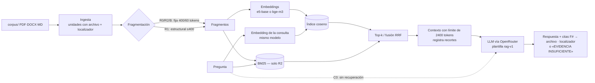

# Informe — Asistente RAG para la Mesa de Ayuda de TI (borrador)

**Equipo:** _(nombres de los tres integrantes)_ · **Curso:** Sistemas Inteligentes Computacionales · **Fecha de entrega:** 23-nov-2026

> Las secciones marcadas con ✏️ se completan después de las corridas finales y de la valoración manual.

## 1. Caso de uso

Mesa de Ayuda de Tecnología de **Andina Tech S.A.S., empresa ficticia**. El asistente apoya a los analistas de nivel 1 y a los empleados en autoservicio respondiendo preguntas sobre la VPN, las cuentas y contraseñas, la autenticación multifactor, el correo, la impresión, las prioridades y tiempos de atención (SLA) y la seguridad del puesto de trabajo. Cada respuesta cita archivo y localizador; si la evidencia no alcanza, el sistema lo declara.

**Fuera de alcance:** costos y licencias, administración de servidores y bases de datos, redes del hogar, desarrollo de software y cualquier acción sobre sistemas (no desbloquea cuentas ni abre casos).

**Corpus (sintético, identificado como tal en cada archivo):**

| Archivo | Formato | Contenido | Localizador |
|---|---|---|---|
| manual_vpn_acceso_remoto.pdf | PDF (texto seleccionable, 3 págs.) | Requisitos, instalación, conexión y errores de la VPN | página + líneas (y sección) |
| guia_seguridad_puesto_trabajo.pdf | PDF (2 págs.) | Bloqueo de equipo, phishing, USB, copias de AndinaDrive | página + líneas (y sección) |
| politica_cuentas_contrasenas.docx | DOCX | Requisitos, bloqueo, restablecimiento, MFA, cuentas | sección + párrafo |
| faq_correo_impresion.md | Markdown | Cuotas, adjuntos, errores SMTP, impresión | líneas + ruta de encabezados |
| catalogo_servicios_sla.md | Markdown | Canales, matriz de prioridades, solicitudes, escalamiento | líneas + ruta de encabezados |

La guía de seguridad se incluyó a propósito como **distractor temático** (habla de contraseñas, VPN y copias de seguridad) para que la recuperación no sea trivial.

## 2. Esquema del flujo

## 3. Configuraciones y parámetros efectivos

| Config. | Cambio frente a R0 | Regla declarada |
|---|---|---|
| R0 | — | Ventana fija de 400 tokens, solapamiento 60 (15 %), sin cruzar documentos; coseno; k=4 |
| R1 | Fragmentación | Cortes solo en límites de párrafo, sin cruzar secciones de primer nivel; se agrupan párrafos completos hasta 400 tokens; sin solapamiento; un párrafo >400 se divide con ventana 400/60 |
| R2 | Recuperación | Coseno + BM25 (k1=1,5; b=0,75) fusionados con RRF (constante 60); k=4 se conserva |
| C0 | Sin recuperación | Mismo LLM; instrucciones adaptadas: responder con conocimiento propio y declarar si carece de información; sin citas |
| B1 / B2 / B3 | Embeddings / LLM / ambos | B1 reconstruye el índice y codifica las consultas con `BAAI/bge-m3` |

**Fijos:** corpus, 9 preguntas, temperatura 0, `top_p` 1, salida máx. 512 tokens, semilla 42, contexto máx. 2400 tokens (fragmentos + encabezados), plantilla `rag-v1` en R0/R1/R2/B*. Unidad de token: tokenizador de `intfloat/multilingual-e5-base` en todas las configuraciones.

**Modelos:** ✏️ (copiar de `meta.json`: identificador configurado y modelo/proveedor servido)

**Entorno de ejecución:** ✏️ (copiar de `meta.json`: Python, versiones, CPU/GPU, fecha)

**Límites de la comparación:** OpenRouter no garantiza que todos los proveedores respeten `seed`; los modelos gratuitos pueden enrutarse a distintos proveedores entre llamadas (se registra el proveedor servido). ✏️ (añadir cualquier otro observado)

## 4. Hipótesis

Ver `HIPOTESIS.md` (registradas el 12-nov-2026, antes de las corridas). ✏️ Pegar aquí el resumen.

## 5. Protocolo de evaluación

- 9 preguntas fijadas antes de las corridas (`evaluacion/preguntas.json`): 3 directas (D1–D3), 3 multidocumento (M1–M3) y 3 sin respuesta en el corpus (U1–U3), con respuesta esperada, evidencia literal y ubicación. `scripts/verificar_evidencia.py` confirma que cada pasaje existe en el corpus.
- 36 corridas de la parte A (9 × R0, R1, R2, C0) y 27 de la parte B. Cada registro guarda pregunta, configuración, fragmentos recuperados en orden, contexto enviado, respuesta, citas, tiempo y valoración; los fallos se registran y se repiten con la misma configuración.
- **Cobertura** (automática): un pasaje se considera presente si aparece completo dentro de un fragmento recuperado / enviado.
- **Corrección, respaldo de citas y abstención:** pre-valoración automática revisada manualmente por el equipo (columnas `*_manual` de `valoracion.csv`). ✏️ Describir cómo se repartió la revisión y cómo se resolvieron los desacuerdos.

## 6. Resultados ✏️

| Config. | Cobertura (recuperados) | Cobertura (contexto) | Corrección | Respaldo de citas | Abstención apropiada | Tiempo medio (s) | Recortes de contexto |
|---|---|---|---|---|---|---|---|
| R0 | /6 | /6 | /6 | | /3 | | |
| R1 | /6 | /6 | /6 | | /3 | | |
| R2 | /6 | /6 | /6 | | /3 | | |
| C0 | no aplica | no aplica | /6 | no se evalúa | /3 | | no aplica |
| B1 | /6 | /6 | /6 | | /3 | | |
| B2 | /6 | /6 | /6 | | /3 | | |
| B3 | /6 | /6 | /6 | | /3 | | |

## 7. Análisis ✏️

- **R1 frente a R0:** ¿la evidencia quedó cortada, unida o con texto irrelevante? Usar la tabla de *rank* de los pasajes del cuaderno y ejemplos concretos de fragmentos.
- **R2 frente a R0:** efecto de BM25 en preguntas con códigos (D1, M2) y en las preguntas sin respuesta (U3).
- **C0 frente a R0:** corrección en las 6 respondibles y abstención en las 3 sin respuesta; recordar que C0 tiene instrucciones adaptadas y que sus citas no se evalúan.
- **Experimento B:** efecto separado de los embeddings (B1) y del LLM (B2), y combinado (B3).
- **Hipótesis confirmadas / refutadas.**

## 8. Configuración recomendada ✏️

## 9. Declaración de uso de IA ✏️

| Herramienta | Uso específico | Cómo se validó |
|---|---|---|
| Claude (Anthropic), modelo Claude Opus 5.5 | Generación del esqueleto de código del paquete `rag/`, del cuaderno, del corpus sintético, del borrador de preguntas de evaluación, de las hipótesis y de este esqueleto de informe | ✏️ (p. ej.: revisión línea a línea del código por cada integrante, ejecución de pruebas, verificación de que cada pasaje de evidencia existe con `verificar_evidencia.py`, lectura y valoración manual de las 63 respuestas, ajustes realizados por el equipo) |
| ✏️ | | |
